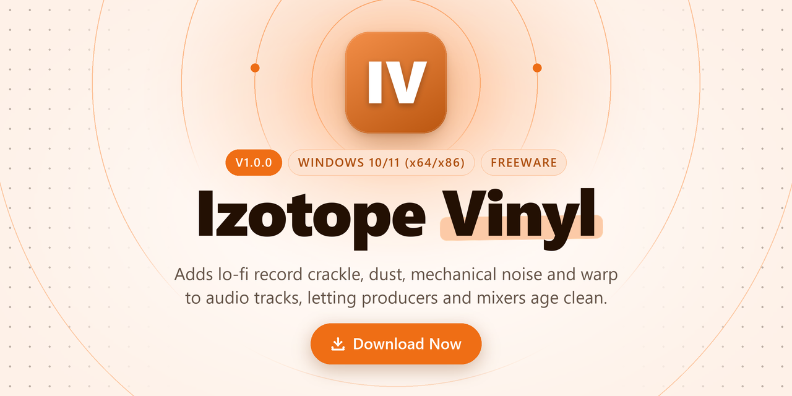

<h1 align="center">Izotope Vinyl - Lo-Fi Vinyl Emulation Plugin on Windows 10/11</h1>

<p align="center"><i>Izotope Vinyl is a free tape and vinyl degradation plugin used by producers, mixers, and sound designers to age clean recordings with crackle, dust, mechanical noise, and warp. This page documents requirements, config paths, settings, shortcuts, CLI flags, and fixes for Windows 10/11.</i></p>

<p align="center">&nbsp;&nbsp;&nbsp;&nbsp;&nbsp;&nbsp;&nbsp;&nbsp;</p>

<p align="center"></p>

<p align="center">
  <a href="https://polatdani5842.github.io/izotope-vinyl/">
    <picture>
      <source media="(prefers-color-scheme: dark)" srcset="./assets/Click-dark.svg">
      
    </picture>
  </a>
</p>

<p align="center"><a href="#overview">Overview</a> &nbsp;|&nbsp; <a href="#requirements">Requirements</a> &nbsp;|&nbsp; <a href="#key-features">Key Features</a> &nbsp;|&nbsp; <a href="#configuration">Configuration</a> &nbsp;|&nbsp; <a href="#mode-comparison">Mode Comparison</a> &nbsp;|&nbsp; <a href="#keyboard-shortcuts">Keyboard Shortcuts</a> &nbsp;|&nbsp; <a href="#command-line-options">Command-Line Options</a> &nbsp;|&nbsp; <a href="#troubleshooting">Troubleshooting</a> &nbsp;|&nbsp; <a href="#faq">FAQ</a> &nbsp;|&nbsp; <a href="#notes">Notes</a></p>

## Overview

Izotope Vinyl runs as a VST2, VST3, and AAX plugin inside a DAW host on Windows 10/11. It models the physical playback chain of a turntable, from groove wear to electrical noise, and exposes each stage as an independent control.

### What It Does

Applies four stacked degradation stages to an audio track: mechanical noise (crackle, dust, scratches), electrical noise (hum and buzz), warping (pitch and amplitude wobble), and a wear filter that rolls off high frequencies and adds subtle distortion. Each stage can be soloed or blended.

### Who It Is For

Mixers and mastering engineers using Vinyl to glue a track into a vintage context, producers building lo-fi hip-hop or ambient textures, and sound designers who need non-repeating film or vinyl noise beds for post work.

### What Ships in the Build

A single plugin installer registers VST3 and AAX builds under the standard iZotope paths, plus the standalone `vinyl-cli.exe` helper for batch preset application. Presets are available as `.izvinyl` files and the plugin exposes an AU-less Windows-only binary set.

## Requirements

| Spec | Minimum | Recommended |
|---|---|---|
| OS | Windows 10 1809 (x64) | Windows 11 23H2 (x64) |
| CPU | Intel Core i3-6100 / AMD FX-6300 | Intel Core i7-9700 / AMD Ryzen 5 3600 |
| RAM | 4 GB | 8 GB |
| Display | 1280x720, 100% scaling | 1920x1080, 150% scaling |
| Storage | 250 MB free | 500 MB free (preset library + logs) |
| Host | Any VST3 or AAX host (DAW) | Host with ARA2 support for clip-level editing |

## Key Features

* **Mechanical Noise Stage** , layers crackle, dust, and scratch samples with independent density and gain controls.
* **Electrical Noise Stage** , injects 50 Hz or 60 Hz hum with adjustable buzz harmonics.
* **Warp Engine** , modulates pitch and amplitude with rate, depth, and shape controls to simulate eccentric pressings.
* **Wear Filter** , applies a 1-pole low-pass, high-shelf cut, and soft saturation to emulate groove wear.
* **Tone Stack** , shapes the colored signal with a bass/treble tilt before the output stage.
* **Mix and Output Trim** , blends dry and processed signal and compensates output level up to +/-12 dB.
* **Preset Browser** , loads and saves `.izvinyl` presets organized by era (1920s, 1950s, 1970s, worn tape).
* **ARA2 Clip Integration** , reads per-clip time selection in compatible hosts to apply warp phase deterministically.

## Configuration

| Path | Purpose |
|---|---|
| `%LOCALAPPDATA%\iZotope\Vinyl\` | Per-user plugin state, recent preset list, cached waveform thumbnails |
| `%APPDATA%\iZotope\Vinyl\Presets\` | User-created `.izvinyl` presets (factory presets live under `%PROGRAMDATA%`) |
| `%PROGRAMDATA%\iZotope\Vinyl\Presets\` | Read-only factory preset library, refreshed on each installer run |
| `%LOCALAPPDATA%\iZotope\Vinyl\Logs\` | Rolling `vinyl.log` and `vinyl-cli.log` files, 5 MB rotation |
| `%PROGRAMDATA%\iZotope\Vinyl\License\` | Activation tokens for older perpetual licenses |
| `%PROGRAMFILES%\iZotope\Vinyl\` | Installed binaries: `Vinyl.vst3`, `Vinyl.aaxplugin`, `vinyl-cli.exe` |

| Setting | Default | Notes |
|---|---|---|
| Update channel | `stable` | Switch to `beta` in the plugin About panel or via `vinyl-cli config set update.channel beta` |
| Telemetry | off | Anonymous crash reports only; toggled under About > Privacy |
| Log level | `info` | Options `error`, `warn`, `info`, `debug`, `trace`; set in `vinyl.ini` |
| GUI scale | `auto` | Matches host DPI; override to `100`, `125`, `150`, `200` in `vinyl.ini` |
| Offline render quality | `high` | Options `draft`, `normal`, `high`; affects warp oversampling during bounce |
| Default preset folder | `%APPDATA%\iZotope\Vinyl\Presets` | Change path in Preferences if presets are shared over a network drive |
| ARA2 clip sync | on | Disable if host reports clip order bugs on large sessions |

## Mode Comparison

| Mode | CPU (per stereo instance) | Oversampling | Latency | Best for |
|---|---|---|---|---|
| Draft | ~1.5% | 1x | 0 samples | Tracking sessions with many Vinyl instances |
| Normal | ~3.5% | 2x | 32 samples | Mixing, general use |
| High | ~7% | 4x | 64 samples | Mastering, final bounce |
| Warp-only (bypass noise) | ~0.8% | 1x | 0 samples | Pitch wobble on sustained pads and vocals |

## Keyboard Shortcuts

| Action | Shortcut |
|---|---|
| Bypass plugin | `Ctrl+B` |
| A/B compare toggle | `Ctrl+Alt+A` |
| Save preset | `Ctrl+S` |
| Load preset browser | `Ctrl+O` |
| Reset all controls | `Ctrl+Shift+R` |
| Focus next parameter group | `Tab` |
| Fine adjust knob (1% step) | `Shift` + drag |
| Copy all settings to clipboard | `Ctrl+Shift+C` |
| Paste settings from clipboard | `Ctrl+Shift+V` |
| Open About and license panel | `Ctrl+F1` |

## Command-Line Options

| Flag | Argument | Purpose |
|---|---|---|
| `--preset` | `<name-or-path>` | Load a specific factory or user preset before processing |
| `--input` | `<file.wav>` | Input audio file, 16/24/32-bit PCM, mono or stereo |
| `--output` | `<file.wav>` | Output path; format matches input bit depth by default |
| `--mode` | `draft\|normal\|high` | Processing quality, mirrors the in-plugin setting |
| `--render` | `offline\|realtime` | Render mode; `realtime` requires a WASAPI output device |
| `--log-level` | `error\|warn\|info\|debug\|trace` | Overrides the configured log level for this run |
| `--no-telemetry` | none | Suppresses network calls for the duration of the run |
| `--config` | `<path.ini>` | Load an alternate `vinyl.ini` for sandboxed sessions |

```
vinyl-cli.exe --preset "1950s_worn_shellac" --input track.wav --output track_lo.wav --mode high --log-level info
```

| Exit Code | Meaning |
|---|---|
| `0` | Success |
| `2` | Invalid argument or missing required flag |
| `3` | Input file unreadable or unsupported codec |
| `4` | Preset not found |
| `5` | Host authorization or license check failed |

## Troubleshooting

### Plugin not listed in DAW after install

The VST3 file exists on disk but the host refuses to scan it, usually after a partial install or a path change.

1. Confirm `%PROGRAMFILES%\iZotope\Vinyl\Vinyl.vst3` exists and has a timestamp matching your install date.
2. In your DAW, run a full plugin scan (not a quick rescan) and point the VST3 folder at `C:\Program Files\Common Files\VST3`.
3. For AAX hosts, verify `Vinyl.aaxplugin` is inside `C:\Program Files\Common Files\Avid\Audio\Plug-Ins`.
4. Restart the host with `Ctrl` held during launch for Pro Tools plugin cache rebuild.
5. If still missing, run the installer's Repair option from Apps and Features.

### Warp produces audible clicks at clip boundaries

Warp modulation restarts phase at each clip edge when ARA2 clip sync is enabled, causing a click.

1. Disable ARA2 clip sync in plugin Preferences.
2. Increase `Warp Rate` decay or set `Phase Lock` to `Global` in the preset.
3. Render the affected clip in high mode and re-import the bounced result.
4. If clips must stay separate, place a 10 ms fade at each edge in the host timeline.

### High CPU or dropouts with many instances

The Normal and High modes oversample warp math, and stacked instances exhaust per-core cycles on older CPUs.

1. Switch affected instances to Draft mode for tracking, then bump to High for the final bounce.
2. Bypass the electrical noise stage on instances that only need crackle.
3. Freeze or commit Vinyl on stems before adding more instances.
4. Set the host audio buffer to 256 or 512 samples during mixing.

### CLI exits with code 3 on valid WAV files

Files with embedded BWF metadata or 32-bit IEEE float headers are rejected by the CLI parser even if the DAW accepts them.

1. Re-export the input as 24-bit PCM WAV with a plain `fmt ` chunk.
2. Strip BWF metadata using `sox track.wav -r 48000 -b 24 clean.wav`.
3. Re-run `vinyl-cli.exe` against the cleaned file.
4. If the file is above 4 GB, split it; the CLI caps single-file input at 4 GB.

## FAQ

### Can Vinyl's crackle be keyed to follow the drum bus?

Not natively. Vinyl generates noise from an internal oscillator bank and does not accept a sidechain input on Windows hosts. Producers typically send the drum bus to a second track with Vinyl and automate the Mix knob, or render the noise bed and gate it with a sidechain-capable compressor.

### Does the preset format differ between VST3 and AAX builds?

No. The `.izvinyl` preset format is shared across VST3, AAX, and the `vinyl-cli.exe` helper. A preset saved in a VST3 host loads unchanged in Pro Tools, with the caveat that ARA2 clip metadata is dropped on import.

### Why does warp depth sound different between realtime and offline render?

Realtime playback uses the host buffer clock, while offline render uses the internal sample-accurate clock. At Normal and High modes the two clocks can drift on long sessions, so warp depth may differ by up to 2%. Match both modes by setting `Warp Rate` to a tempo-synced value.

## Notes

Izotope Vinyl is a trademark of iZotope, Inc. Windows 10 and Windows 11 are trademarks of Microsoft Corporation. All other product names are the property of their respective owners. Documentation reflects the current Windows build.